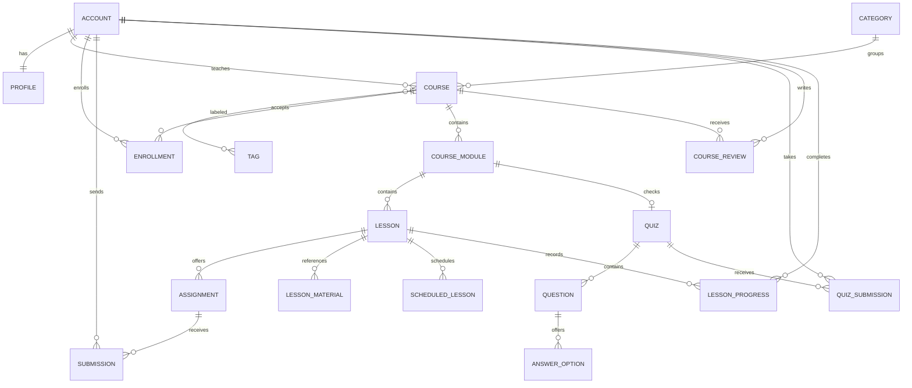

# Модель данных и архитектурные решения

## 18 сущностей

| Сущность / таблица | Назначение и ключевые связи |
|---|---|
| Account / accounts | Пользователь, уникальная нормализованная почта, BCrypt, роль |
| Profile / profiles | 1:1 с Account, уникальный FK, редко используемые данные |
| Category / categories | Категория, N:1 со стороны Course |
| Tag / tags | M:N с Course через course_tags |
| Course / courses | N:1 с преподавателем и категорией, 1:N с модулями |
| CourseModule / course_modules | N:1 с Course, 1:N с Lesson |
| Lesson / lessons | N:1 с модулем, 1:N с Assignment |
| Enrollment / enrollments | M:N студент–курс через сущность с датой и статусом |
| Assignment / assignments | Задание урока, дедлайн, максимальный балл |
| Submission / submissions | Студент + задание + содержимое + оценка |
| Quiz / quizzes | 1:1 с модулем, 1:N с Question |
| Question / questions | Тип SINGLE_CHOICE/MULTIPLE_CHOICE, вес, 1:N с AnswerOption |
| AnswerOption / answer_options | Вариант вопроса и серверный флаг правильности |
| QuizSubmission / quiz_submissions | Студент + тест + результат |
| CourseReview / course_reviews | Студент + курс + рейтинг и отзыв |
| LessonMaterial / lesson_materials | HTTPS-ссылка на материал урока |
| ScheduledLesson / scheduled_lessons | Занятие урока, время, ссылка |
| LessonProgress / lesson_progress | Студент + урок + дата завершения |

`BaseEntity` — `@MappedSuperclass`, не девятнадцатая сущность. `course_tags` — таблица соединения, а не отдельный JPA-класс. У всех 18 сущностей есть генерируемый PK и `@Version`.

## Транзакции и загрузка

Контроллеры не работают с EntityManager и не сериализуют JPA-сущности. Сервисы возвращают DTO, собранные внутри транзакции; чтения — `@Transactional(readOnly = true)`, изменения — отдельные транзакции записи.

Все ассоциации явно LAZY. Обе связи OneToOne находятся на стороне с FK: загрузка Account не требует существования обратного прокси Profile. Это позволяет не полагаться на ненадёжную ленивость необязательного inverse OneToOne без bytecode enhancement.

Open Session in View отключён. `PersistenceIntegrationTest` воспроизводит `LazyInitializationException` после закрытия сессии и показывает два решения: транзакционную навигацию и целевой `JOIN FETCH`. `findDetailedById` использует `EntityGraph`.

Программа курса собирается двумя запросами к спискам модулей и уроков, без запроса на уроки для каждого модуля. Каталог использует EntityGraph для преподавателя и категории вместе с пагинацией, не fetch join коллекции. Для остальных навигаций включена пакетная загрузка по 32 объекта. Несколько List-коллекций одним fetch join не загружаются.

## Ограничения и конкурентность

- Уникальны почта, названия справочников, профиль пользователя, тест модуля.
- Уникальны пары студент–курс, студент–задание, студент–тест, студент–отзыв курса, студент–урок.
- Позиции уникальны внутри родителя. PostgreSQL CHECK проверяет роли, типы вопросов, положительные позиции и баллы, рейтинг 1–5, порядок дат занятия.
- Проверки сервисов дают понятную ошибку; уникальные ограничения БД остаются последним рубежом при гонке двух запросов. Это отдельно проверяется конкурентным тестом записи на курс.
- `@Version` обнаруживает конфликт параллельных изменений.
- При редактировании и прохождении теста берётся одна и та же `PESSIMISTIC_WRITE`-блокировка Quiz. Проверка наличия результатов выполняется после блокировки. После первой попытки менять тест, вопросы и варианты нельзя.
- Балл задания проверяется относительно его максимума в сервисе. После получения работ условия задания менять нельзя.
- Время бизнес-сценариев берётся из внедрённого `Clock`, дедлайн считается истёкшим при `now >= dueAt`.

## Удаление

У Course → Module → Lesson и Quiz → Question → AnswerOption настроены JPA cascade/orphanRemoval. Для принадлежащих объектов схема также задаёт `ON DELETE CASCADE`, включая материалы и расписание. Удаление Account удаляет его профиль на уровне FK.

Записи, решения, прогресс, отзывы и результаты **не удаляются каскадно**. FK запрещает удаление их родителей; сервис делает flush в транзакции, клиент получает 409, вся операция откатывается. Удалять курс можно, только когда нет защищаемых связей. Отписка удаляет только Enrollment, не историю.

Удаление курса очищает связи `course_tags`, но не сами теги и не преподавателя/категорию. На ManyToMany нет CascadeType.REMOVE.

Решения и результаты — исторические записи: пользовательский CRUD ограничен намеренно. Решение создаётся один раз, читается и обновляется только через оценивание. Результат теста неизменяем. Это не пропущенные CRUD-методы.

## Безопасность

Пароли хешируются BCrypt; хеши никогда не входят в DTO. Регистрация не принимает роль; преподавателей создаёт администратор. JWT подписан HS256, проверяются подпись, срок и issuer. Секрет обязателен и должен быть минимум 64 байта.

API stateless, не использует аутентификационные cookies или HTTP Basic. CSRF отключён именно для Bearer-аутентификации: браузер не добавляет такой заголовок автоматически. Интерфейс хранит токен только в памяти вкладки, не в localStorage; перезагрузка требует повторного входа. Выход очищает клиентский токен; серверного blacklist/refresh-токенов в учебной версии нет.

Проверки авторства, роли и записи на курс находятся в сервисах; подмена studentId не позволяет читать чужие работы. Флаг `correct` виден только преподавателю своего курса и ADMIN. Для ссылок разрешён HTTPS, пользовательский текст экранируется перед вставкой в DOM.

Для публичной эксплуатации дополнительно нужны TLS, управление секретами, ограничение частоты входа и регистрации, политика резервного копирования и аудит действий. Учебный Docker Compose публикует сервисы только на loopback.

## Ответственность модулей

| Сервис | Ответственность |
|---|---|
| AccessService | Текущий пользователь, роли, авторство, доступ к контенту |
| AccountService | Регистрация, вход, пользователи, профили |
| TaxonomyService | Категории и теги |
| CatalogService | Курсы, теги курсов, программа |
| ContentService | Модули, уроки, материалы, расписание |
| EnrollmentService | Запись, статусы, списки, отписка |
| AssignmentService | Задания, решения, оценивание |
| ActivityService | Отзывы, прогресс, статистика |
| QuizService | Тесты, вопросы, варианты, попытки и результаты |
| QuizScorer | Чистый алгоритм проверки ответов без БД |

Frontend, DTO, ORM и транзакции разделены. Зависимости внедряются через конструкторы. Lombok используется только для конструкторов/getter/setter; `@Data`, рекурсивные `toString` и равенство по изменяемым ассоциациям не используются.
